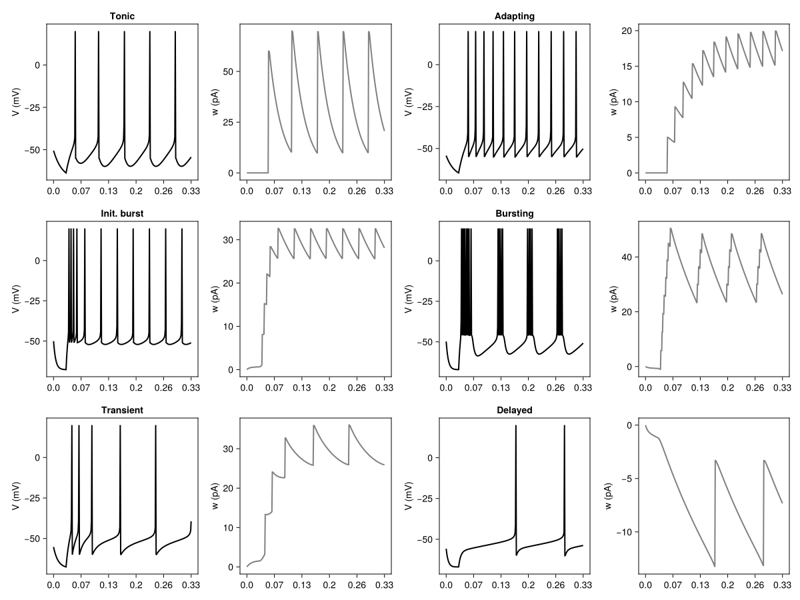
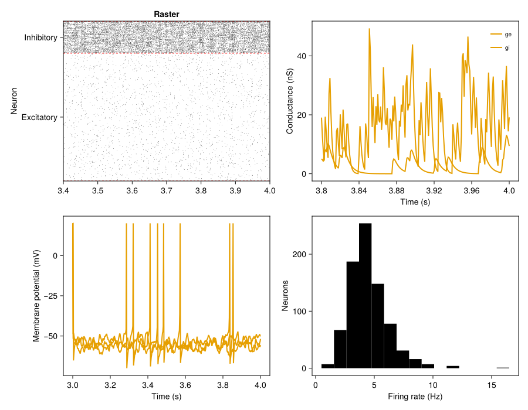
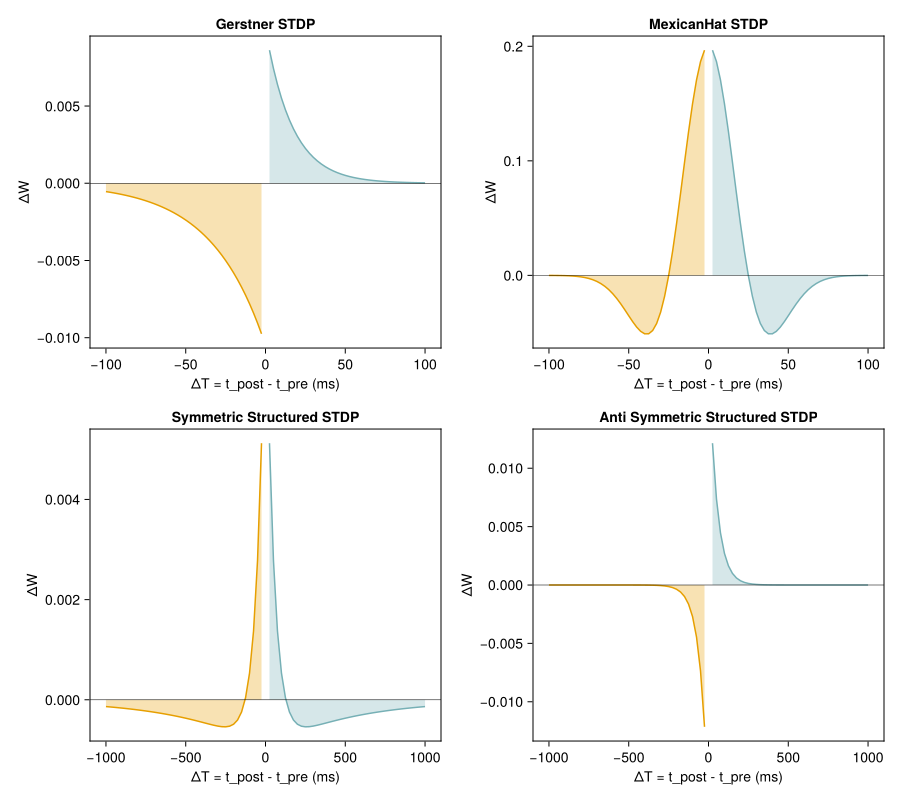
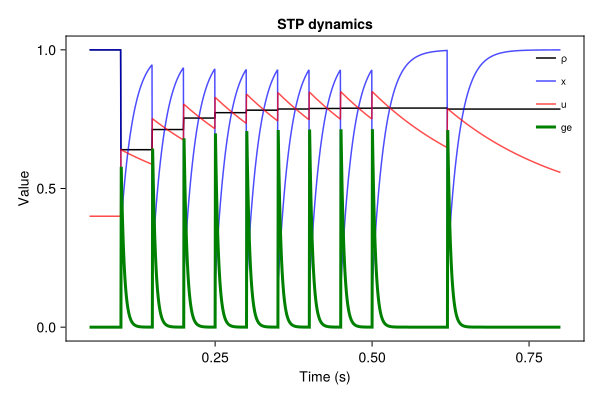
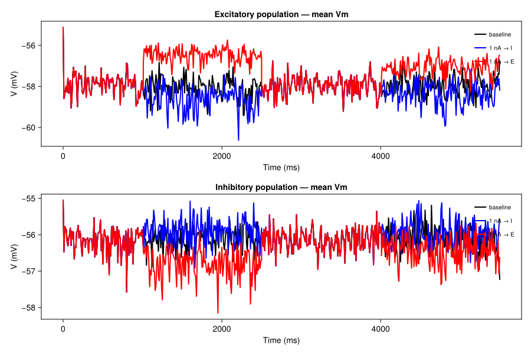
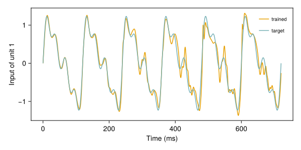
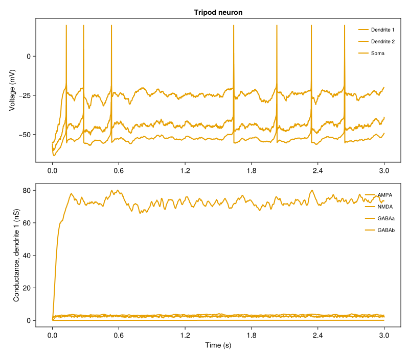
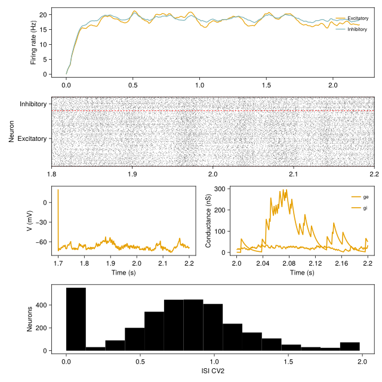

# SNNExamples

Runnable examples of the [JuliaSNN](https://github.com/JuliaSNN) packages: single neurons, networks, plasticity,
rate models, perturbations, extensions of the model library, and re-implementations of published models.

JuliaSNN is a set of Julia packages to simulate networks of spiking neurons (point and dendritic neuron models,
conductance and receptor synapses, delays, long- and short-term plasticity, Poisson and spike-time inputs) and to
record, analyse and plot the results:

| Package | Role |
|:--|:--|
| [SNNModels.jl](https://github.com/JuliaSNN/SNNModels.jl) | models and simulation engine |
| [SpikingNeuralNetworks.jl](https://github.com/JuliaSNN/SpikingNeuralNetworks.jl) | loads and re-exports the packages below (`using SpikingNeuralNetworks`, alias `SNN`) |
| [SNNPlots.jl](https://github.com/JuliaSNN/SNNPlots.jl) | plots of recordings (Makie) |
| [SNNUtils.jl](https://github.com/JuliaSNN/SNNUtils.jl) | stimulation protocols and analysis |

Documentation: <https://juliasnn.github.io/SpikingNeuralNetworks.jl>. The examples run with SNNModels 2.1.0,
SpikingNeuralNetworks 2.0.1, SNNUtils 1.0.0 and SNNPlots 1.0.0 (see [`Project.toml`](Project.toml)).

This repository is not a Julia package and is not registered: `Project.toml` and `Manifest.toml` only pin the environment the
examples run in. Clone it and instantiate the project as shown below.

<!-- figures:begin -->
<table>
<tr><td align="center"><br><sub>Firing patterns of the AdEx neuron<br><a href="tutorials/neurons/AdEx_neuron.jl"><code>tutorials/neurons/AdEx_neuron.jl</code></a></sub></td><td align="center"><br><sub>E/I network of AdEx and IF neurons: raster, traces, rates<br><a href="tutorials/networks/AdEx_net.jl"><code>tutorials/networks/AdEx_net.jl</code></a></sub></td></tr>
<tr><td align="center"><br><sub>STDP kernels of the long-term plasticity rules<br><a href="tutorials/STDP_kernel.jl"><code>tutorials/STDP_kernel.jl</code></a></sub></td><td align="center"><br><sub>Short-term plasticity: efficacy, resources and utilisation<br><a href="tutorials/plasticity/STP_demo.jl"><code>tutorials/plasticity/STP_demo.jl</code></a></sub></td></tr>
<tr><td align="center"><br><sub>Perturbing a running E/I network<br><a href="tutorials/perturbations/EI_network_perturbation.jl"><code>tutorials/perturbations/EI_network_perturbation.jl</code></a></sub></td><td align="center"><br><sub>Rate network trained to follow a target (PINning)<br><a href="tutorials/rate_models/pinning_net.jl"><code>tutorials/rate_models/pinning_net.jl</code></a></sub></td></tr>
<tr><td align="center"><br><sub>Tripod neuron: soma, dendrites and receptor conductances<br><a href="tutorials/neurons/Tripod_neuron.jl"><code>tutorials/neurons/Tripod_neuron.jl</code></a></sub></td><td align="center"><br><sub>COBA benchmark network<br><a href="tutorials/networks/COBA.jl"><code>tutorials/networks/COBA.jl</code></a></sub></td></tr>
</table>
<!-- figures:end -->

## Run an example

```bash
git clone https://github.com/JuliaSNN/SNNExamples.git
cd SNNExamples
julia --project=. -e 'using Pkg; Pkg.instantiate()'       # first time only, a few minutes

julia --project=. tutorials/neurons/AdEx_neuron.jl         # run a script
julia --project=. scripts/run_example.jl tutorials/neurons/AdEx_neuron.jl   # headless: saves the figures to figures/
```

Most scripts end with a Makie figure. In the Julia REPL or in VS Code `include("tutorials/neurons/AdEx_neuron.jl")`
shows it; `scripts/run_example.jl` runs the script with the CairoMakie PNG backend and writes every figure it
creates to `figures/` (use `--figdir DIR` and `--max-figs N` to change this). Each script starts with a comment that says what it
shows and how long it takes (the time includes Julia start-up and compilation, on a 24-core workstation).

The tutorials follow the pages of the documentation ([populations](https://juliasnn.github.io/SpikingNeuralNetworks.jl/dev/tutorials/populations/),
[plasticity](https://juliasnn.github.io/SpikingNeuralNetworks.jl/dev/tutorials/plasticity/),
[simulations](https://juliasnn.github.io/SpikingNeuralNetworks.jl/dev/tutorials/simulations/)).

## Layout

| Folder | Content |
|:--|:--|
| `tutorials/` | `neurons/`, `networks/`, `plasticity/`, `rate_models/`, `perturbations/`, `extensions/`, `analysis/`, `usage/` (saving and loading models, the graph of a model, a SLURM job), and a few scripts at the top level (spike-time stimulus, STDP) |
| `experiments/` | re-implementations of published models: Mongillo 2008, Litwin-Kumar & Doiron 2014, Tsodyks 1997, Potjans & Diesmann 2014, Zerlaut 2019, Festa 2024, competing assemblies, and others, plus `parameters/` (parameter sets used by other projects); some are not runnable, see [STATUS.md](STATUS.md) |
| `scripts/` | `run_example.jl` (headless runner), `run_all.jl` (runs everything with timeouts), `make_status.jl`, `examples.toml` (the list of examples) |
| `.github/workflows/` | CI: smoke run of a few fast examples |
| `figures/` | PNG figures written by the runner |
| `STATUS.md` | result of the last full run: pass, fixed, not run, with the reason |

## Examples

Status: **pass** = ran as it came from SpikingNeuralNetworks.jl, **fixed** = ported to the current API and now runs,
**not run** = not executed (cluster data, removed models, unfinished code; reason in [STATUS.md](STATUS.md)).
"Ran" means the script finished without error; STATUS.md also lists observations about results that look wrong
(for example the Izhikevich tutorials).

<!-- examples:begin -->

### Tutorials: neurons

| Example | What it shows | Status |
|:--|:--|:--|
| [`tutorials/neurons/IF_neuron.jl`](tutorials/neurons/IF_neuron.jl) | IF neuron under excitatory and inhibitory Poisson input | pass |
| [`tutorials/neurons/IF_noise_input.jl`](tutorials/neurons/IF_noise_input.jl) | IF neuron under a noisy input current | pass |
| [`tutorials/neurons/AdEx_neuron.jl`](tutorials/neurons/AdEx_neuron.jl) | AdEx firing patterns under a current step (Naud et al. 2008) | pass |
| [`tutorials/neurons/AdEx_threshold.jl`](tutorials/neurons/AdEx_threshold.jl) | AdEx neuron with an adaptive spike threshold | pass |
| [`tutorials/neurons/AdEx_balanced_stimuli.jl`](tutorials/neurons/AdEx_balanced_stimuli.jl) | AdEx neuron in the high-conductance state, balanced Poisson input | pass |
| [`tutorials/neurons/AdEx_multireceptors.jl`](tutorials/neurons/AdEx_multireceptors.jl) | AdEx neuron with AMPA/NMDA/GABA-type receptors of different kinetics | pass |
| [`tutorials/neurons/Izikievich_neuron.jl`](tutorials/neurons/Izikievich_neuron.jl) | Izhikevich firing patterns | pass |
| [`tutorials/neurons/HH_neuron.jl`](tutorials/neurons/HH_neuron.jl) | Hodgkin-Huxley neuron, f-I curve | pass |
| [`tutorials/neurons/MorrisLecar_neuron.jl`](tutorials/neurons/MorrisLecar_neuron.jl) | Morris-Lecar neuron, noisy current and phase plane | pass |
| [`tutorials/neurons/BallAndStick_neuron.jl`](tutorials/neurons/BallAndStick_neuron.jl) | Ball-and-stick neuron, receptor conductances | pass |
| [`tutorials/neurons/Tripod_neuron.jl`](tutorials/neurons/Tripod_neuron.jl) | Tripod neuron (soma and two dendrites), AMPA/NMDA/GABA receptors | pass |
| [`tutorials/neurons/Tripod_multireceptors.jl`](tutorials/neurons/Tripod_multireceptors.jl) | Tripod neuron with three GABA receptors | pass |
| [`tutorials/neurons/tripod2.jl`](tutorials/neurons/tripod2.jl) | Tripod neuron under dendritic Poisson input | pass |
| [`tutorials/neurons/HetRec_layer.jl`](tutorials/neurons/HetRec_layer.jl) | HetRec layer with heterogeneous dendritic time constants | pass |
| [`tutorials/neurons/PoissonPop.jl`](tutorials/neurons/PoissonPop.jl) | Poisson population: raster, rates, ISI CV2 | pass |
| [`tutorials/timed_stim.jl`](tutorials/timed_stim.jl) | Spike-time stimulus | pass |

### Tutorials: networks

| Example | What it shows | Status |
|:--|:--|:--|
| [`tutorials/networks/IF_net.jl`](tutorials/networks/IF_net.jl) | Balanced IF network (3200 E, 800 I) | pass |
| [`tutorials/networks/HH_net.jl`](tutorials/networks/HH_net.jl) | Hodgkin-Huxley network (no figure) | pass |
| [`tutorials/networks/Izikievich_net.jl`](tutorials/networks/Izikievich_net.jl) | Izhikevich network | pass |
| [`tutorials/networks/AdEx_net.jl`](tutorials/networks/AdEx_net.jl) | AdEx/IF network with heterogeneous parameters and delays | pass |
| [`tutorials/networks/AdExVarStimuli.jl`](tutorials/networks/AdExVarStimuli.jl) | Network driven by a time-varying Poisson rate | pass |
| [`tutorials/networks/COBA.jl`](tutorials/networks/COBA.jl) | COBA benchmark network (Brette et al. 2007) | pass |
| [`tutorials/networks/CUBA.jl`](tutorials/networks/CUBA.jl) | CUBA benchmark network (Brette et al. 2007) | pass |
| [`tutorials/networks/CUBA_brian.py`](tutorials/networks/CUBA_brian.py) | CUBA benchmark in Brian2, for the speed comparison | not run |
| [`tutorials/networks/afferent_response.jl`](tutorials/networks/afferent_response.jl) | Network rate against afferent rate (Zerlaut et al. 2019 parameters) | pass |
| [`tutorials/networks/weak_strong_afferents.jl`](tutorials/networks/weak_strong_afferents.jl) | Network synchrony against afferent rate | pass |
| [`tutorials/networks/ParadoxicalEffect.jl`](tutorials/networks/ParadoxicalEffect.jl) | Paradoxical response of an inhibition-stabilised network (Tsodyks et al. 1997) | pass |
| [`tutorials/networks/passive_vs_active_dendrites.jl`](tutorials/networks/passive_vs_active_dendrites.jl) | Networks of passive and NMDA-active dendrites | pass |
| [`tutorials/networks/out_degree.jl`](tutorials/networks/out_degree.jl) | Out-degree distributions of the connectivity rules | pass |
| [`tutorials/networks/chain.jl`](tutorials/networks/chain.jl) | Feed-forward chain of three IF neurons | fixed |

### Tutorials: plasticity

| Example | What it shows | Status |
|:--|:--|:--|
| [`tutorials/plasticity/STP_demo.jl`](tutorials/plasticity/STP_demo.jl) | Short-term plasticity of one synapse: ρ, u, x | pass |
| [`tutorials/networks/AdEx_STP.jl`](tutorials/networks/AdEx_STP.jl) | Network with short-term depression | pass |
| [`tutorials/networks/STP_het.jl`](tutorials/networks/STP_het.jl) | Heterogeneous short-term plasticity from experimental fits | pass |
| [`tutorials/stdp_demo.jl`](tutorials/stdp_demo.jl) | Pair STDP: weight change against spike-time difference | pass |
| [`tutorials/STDP_kernel.jl`](tutorials/STDP_kernel.jl) | Kernels of all long-term plasticity rules | pass |
| [`tutorials/plasticity/AdEx_plasticity.jl`](tutorials/plasticity/AdEx_plasticity.jl) | vSTDP network with synaptic normalisation | pass |
| [`tutorials/networks/synaptic_turnover.jl`](tutorials/networks/synaptic_turnover.jl) | Random synaptic turnover | pass |
| [`tutorials/plasticity/AdEx_turnover.jl`](tutorials/plasticity/AdEx_turnover.jl) | Activity-dependent turnover in space | pass |
| [`tutorials/plasticity/aggregate_scaling.jl`](tutorials/plasticity/aggregate_scaling.jl) | Homeostatic aggregate scaling towards a target rate | fixed |

### Tutorials: rate models

| Example | What it shows | Status |
|:--|:--|:--|
| [`tutorials/rate_models/rate_net.jl`](tutorials/rate_models/rate_net.jl) | Rate network | pass |
| [`tutorials/rate_models/Oja_rule.jl`](tutorials/rate_models/Oja_rule.jl) | Oja rule in a rate network | pass |
| [`tutorials/rate_models/pinning_net.jl`](tutorials/rate_models/pinning_net.jl) | PINning: recurrent network trained on a target | pass |
| [`tutorials/rate_models/ppc.jl`](tutorials/rate_models/ppc.jl) | Rate network with a trained readout | pass |

### Tutorials: perturbations, extensions, analysis

| Example | What it shows | Status |
|:--|:--|:--|
| [`tutorials/perturbations/EI_network_perturbation.jl`](tutorials/perturbations/EI_network_perturbation.jl) | Perturbing a running E/I network | pass |
| [`tutorials/extensions/neuron_model.jl`](tutorials/extensions/neuron_model.jl) | Defining a new neuron model | pass |
| [`tutorials/extensions/stimulus_model.jl`](tutorials/extensions/stimulus_model.jl) | Defining a new stimulus model | pass |
| [`tutorials/extensions/doubleExpCurrent.jl`](tutorials/extensions/doubleExpCurrent.jl) | Defining a new synapse model | pass |
| [`tutorials/analysis/recordings.jl`](tutorials/analysis/recordings.jl) | Every way to read a recording | pass |
| [`tutorials/analysis/simulation_speed.jl`](tutorials/analysis/simulation_speed.jl) | Simulation speed of AdEx, Tripod and BallAndStick (BenchmarkTools) | fixed |

### Tutorials: usage

| Example | What it shows | Status |
|:--|:--|:--|
| [`tutorials/usage/load_model.jl`](tutorials/usage/load_model.jl) | Save a network, load it, continue it, rerun it without one stimulus | pass |
| [`tutorials/usage/get_graph.jl`](tutorials/usage/get_graph.jl) | Graph of a model (populations, synapses, stimuli) | fixed |
| [`tutorials/usage/load_cluster.jl`](tutorials/usage/load_cluster.jl) | SLURM job: one network per worker process, saved to disk | fixed |

### Experiments: papers

| Example | What it shows | Status |
|:--|:--|:--|
| [`experiments/Mongillo2008_WorkingMemory/STP_onecell.jl`](experiments/Mongillo2008_WorkingMemory/STP_onecell.jl) | Mongillo et al. 2008: Tsodyks-Markram synapse, x and u after a spike train | fixed |
| [`experiments/Mongillo2008_WorkingMemory/STP_WM_Mongillo2008.jl`](experiments/Mongillo2008_WorkingMemory/STP_WM_Mongillo2008.jl) | Mongillo et al. 2008: working memory by synaptic facilitation, 10,000 neurons | fixed |
| [`experiments/OtherPapers/Tsodyks1997_ParadoxicalEffect.jl`](experiments/OtherPapers/Tsodyks1997_ParadoxicalEffect.jl) | Tsodyks et al. 1997: paradoxical effect, 2000 AdEx + 500 IF neurons | fixed |
| [`experiments/OtherPapers/LitwinKumar2014_vSTDPNetwork.jl`](experiments/OtherPapers/LitwinKumar2014_vSTDPNetwork.jl) | Litwin-Kumar & Doiron 2014: balanced AdEx network with their parameters | fixed |
| [`experiments/Festa2024_StructuredInhibition/structured_inhibition_symmetric_STDP_network.jl`](experiments/Festa2024_StructuredInhibition/structured_inhibition_symmetric_STDP_network.jl) | Festa et al. 2024: structured inhibition with symmetric STDP on I -> E (550 s) | fixed |
| [`experiments/Festa2024_StructuredInhibition/structured_inhibition_asymmetric_STDP_network.jl`](experiments/Festa2024_StructuredInhibition/structured_inhibition_asymmetric_STDP_network.jl) | Festa et al. 2024: structured inhibition with anti-symmetric STDP on I -> E (650 s) | fixed |
| [`experiments/LitwinKumar2014_AssociativeMemories/simulation.jl`](experiments/LitwinKumar2014_AssociativeMemories/simulation.jl) | Litwin-Kumar & Doiron 2014: network with vSTDP, iSTDP and normalisation, 3 s | fixed |
| [`experiments/PotjansDiesmann2014_CorticalCircuit/multilayer_potjans-diesmann2015.jl`](experiments/PotjansDiesmann2014_CorticalCircuit/multilayer_potjans-diesmann2015.jl) | Potjans & Diesmann 2014: 8-population cortical microcircuit at 1 % scale | fixed |
| [`experiments/Zerlaut2019_SpectrumAsynchronous/simulation_example.jl`](experiments/Zerlaut2019_SpectrumAsynchronous/simulation_example.jl) | Zerlaut et al. 2019: raster and rates of the 10,000-neuron network at 4 and 10 Hz | fixed |
| [`experiments/Zerlaut2019_SpectrumAsynchronous/simulation_standalone.jl`](experiments/Zerlaut2019_SpectrumAsynchronous/simulation_standalone.jl) | Zerlaut et al. 2019: transfer function, 4000 E + 1000 I, 20 rates x 5 runs | fixed |
| [`experiments/Zerlaut2019_SpectrumAsynchronous/simulation.jl`](experiments/Zerlaut2019_SpectrumAsynchronous/simulation.jl) | Zerlaut et al. 2019: transfer function, 8000 E + 2000 I, 20 rates x 5 runs | fixed |
| [`experiments/tripod_soma.jl`](experiments/tripod_soma.jl) | Tripod neuron: response to one excitatory and one inhibitory somatic spike | fixed |

### Experiments: competing assemblies (BistablePopulations)

| Example | What it shows | Status |
|:--|:--|:--|
| [`experiments/BistablePopulations/two_competing_populations.jl`](experiments/BistablePopulations/two_competing_populations.jl) | Two E/I networks competing through lateral excitation of inhibition | fixed |
| [`experiments/BistablePopulations/bistable_network_with_stimulus.jl`](experiments/BistablePopulations/bistable_network_with_stimulus.jl) | Two assemblies and an alternating decaying stimulus | fixed |
| [`experiments/BistablePopulations/multistable_network_with_stimulus.jl`](experiments/BistablePopulations/multistable_network_with_stimulus.jl) | Four assemblies with inhibitory plasticity, two cued in turn | fixed |
| [`experiments/BistablePopulations/persistent_adapting_activity.jl`](experiments/BistablePopulations/persistent_adapting_activity.jl) | Persistent activity with four inhibitory plasticity rules (40 s each) | fixed |

### Experiments: not run

| Example | What it shows | Status |
|:--|:--|:--|
| [`experiments/Lagzi2022_AssemblyFormation/simulation_stdp_baseline.jl`](experiments/Lagzi2022_AssemblyFormation/simulation_stdp_baseline.jl) | Lagzi et al. 2022: STDP training of the assembly network over a grid of stimulus rate x timescale x SST count | not run |
| [`experiments/Lagzi2022_AssemblyFormation/simulation_stdp_run.jl`](experiments/Lagzi2022_AssemblyFormation/simulation_stdp_run.jl) | Lagzi et al. 2022: single STDP training run | not run |
| [`experiments/Lagzi2022_AssemblyFormation/simulation_stdp_test.jl`](experiments/Lagzi2022_AssemblyFormation/simulation_stdp_test.jl) | Lagzi et al. 2022: 5 s test of the network with NMDA and AMPA receptors | not run |
| [`experiments/Lagzi2022_AssemblyFormation/simulation_stdp_load.jl`](experiments/Lagzi2022_AssemblyFormation/simulation_stdp_load.jl) | Lagzi et al. 2022: load trained networks and analyse the weights | not run |
| [`experiments/Lagzi2022_AssemblyFormation/simulation_stdp_load_mixed.jl`](experiments/Lagzi2022_AssemblyFormation/simulation_stdp_load_mixed.jl) | Lagzi et al. 2022: load trained networks with mixed inhibition | not run |
| [`experiments/Lagzi2022_AssemblyFormation/simulation_stdp_baseline_analysis.jl`](experiments/Lagzi2022_AssemblyFormation/simulation_stdp_baseline_analysis.jl) | Lagzi et al. 2022: analysis of the baseline grid | not run |
| [`experiments/Lagzi2022_AssemblyFormation/simulation_auditory_stim_response.jl`](experiments/Lagzi2022_AssemblyFormation/simulation_auditory_stim_response.jl) | Lagzi et al. 2022: response of trained networks to recorded sounds | not run |
| [`experiments/Lagzi2022_AssemblyFormation/simulation_auditory_stim_response_analysis.jl`](experiments/Lagzi2022_AssemblyFormation/simulation_auditory_stim_response_analysis.jl) | Lagzi et al. 2022: analysis of the sound responses | not run |
| [`experiments/Lagzi2022_AssemblyFormation/auditory_spikes.jl`](experiments/Lagzi2022_AssemblyFormation/auditory_spikes.jl) | Lagzi et al. 2022: Poisson spikes sampled from auditory cortex rates | not run |
| [`experiments/Lagzi2022_AssemblyFormation/autocor.jl`](experiments/Lagzi2022_AssemblyFormation/autocor.jl) | Lagzi et al. 2022: autocorrelation of the Ornstein-Uhlenbeck rate signal | not run |
| [`experiments/Lagzi2022_AssemblyFormation/autocor_STDP.jl`](experiments/Lagzi2022_AssemblyFormation/autocor_STDP.jl) | Lagzi et al. 2022: autocorrelation of the signal after STDP | not run |
| [`experiments/Vlachos2025_Sequences/simulation.jl`](experiments/Vlachos2025_Sequences/simulation.jl) | Vlachos et al. 2025: sequences in a network of multi-timescale AdEx neurons | not run |
| [`experiments/Sarazin2022_NeuralSequences/if_CANAHP_net.jl`](experiments/Sarazin2022_NeuralSequences/if_CANAHP_net.jl) | Sarazin et al. 2022: IF network with CAN and AHP currents | not run |
| [`experiments/Seeholzer2019_RingAttractor/simulation.jl`](experiments/Seeholzer2019_RingAttractor/simulation.jl) | Seeholzer et al. 2019: ring attractor network | not run |
| [`experiments/Seeholzer2019_RingAttractor/optimization.jl`](experiments/Seeholzer2019_RingAttractor/optimization.jl) | Seeholzer et al. 2019: parameter optimisation on a cluster | not run |
| [`experiments/PotjansDiesamann2014_network/potjans_nmnist.jl`](experiments/PotjansDiesamann2014_network/potjans_nmnist.jl) | Potjans-Diesmann network driven by N-MNIST event data | not run |
| [`experiments/PotjansDiesamann2014_network/batch_nmnist_motions.py`](experiments/PotjansDiesamann2014_network/batch_nmnist_motions.py) | N-MNIST batch conversion | not run |

### Experiments: parameters

| Example | What it shows | Status |
|:--|:--|:--|
| [`experiments/parameters/dendritic_WM.jl`](experiments/parameters/dendritic_WM.jl) | Parameters/network function for a working-memory model of ball-and-stick neurons | not run |
| [`experiments/parameters/dendritic_network_phoncat.jl`](experiments/parameters/dendritic_network_phoncat.jl) | Parameters of the dendritic networks (Tripod/ball-and-stick, PV, SST) of the phoneme-categorisation project | not run |

<!-- examples:end -->

## Check everything

```bash
julia --project=. scripts/run_all.jl            # every example in its own process, at most 6 in parallel, 300 s timeout
julia --project=. scripts/run_all.jl tutorials/neurons --jobs 2   # a folder or single scripts
julia --project=. scripts/make_status.jl        # rewrites STATUS.md and the table above
```

Logs are written to `_logs/` (ignored by git).

## Adding an example

1. Put the script in the matching folder of `tutorials/` or `experiments/`. Start it with a comment that says what it shows and
   how long it takes, for example `# Runtime: about 40 s.` (look at any script in `tutorials/neurons/`).
2. Add an `[[example]]` entry to `scripts/examples.toml` (`path`, `topic`, `desc`, `status`, `reason`, `changed`, `origin`, `note`).
3. Check it: `julia --project=. scripts/run_example.jl <path>`; the last output line is `RESULT pass|fail ...`.
4. Run `julia --project=. scripts/make_status.jl` to rewrite STATUS.md and the table above.

## Notes

- SNNModels 2.1.0 changed the Tripod and BallAndStick defaults (soma clamp, GABA reversal potentials, dendrite
  diameter); results of the Tripod examples differ from earlier versions. See the
  [SNNModels changelog](https://github.com/JuliaSNN/SNNModels.jl/blob/main/CHANGELOG.md).
- Upgrading code from version 1 of the packages: [What changes from v1 to v2](https://juliasnn.github.io/SpikingNeuralNetworks.jl/dev/#What-changes-from-v1-to-v2).
- License: MIT, see [LICENSE](LICENSE).
